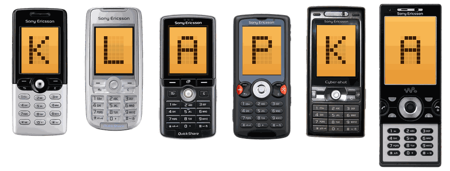
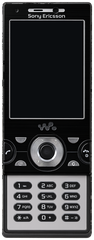
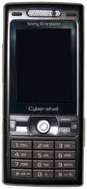
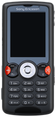
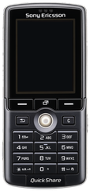
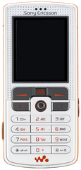
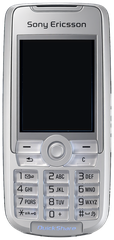
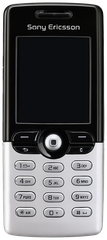

# KLAPKA

**Koksny's Legacy Archive of Phones Keypads Assets**

The phones we grew up with, as clean skins with a see-through screen. 
Free, measured to scale, ready for your watch face, wallpaper or emulator.

<!-- COUNT:START -->
**7 phones** from 1 brand, 2003–2009
<!-- COUNT:END -->

<a href="#browse">Browse</a> · <a href="#get-a-skin-no-git-needed">Download</a> · <a href="https://github.com/koksny/klapka/issues/new?template=request-a-phone.yml">Request a phone</a> · <a href="AGENTS.md">For AI agents</a>

---

## Browse

<!-- BROWSE:START -->
- **[By year](catalog/years.md)**: [2003](catalog/years/2003.md) · [2004](catalog/years/2004.md) · [2005](catalog/years/2005.md) · [2006](catalog/years/2006.md) · [2009](catalog/years/2009.md)
- **[By brand](catalog/brands.md)**: [Sony Ericsson](phones/sony-ericsson/)
- **[By type](catalog/types.md)**: [Candybar](catalog/types/candybar.md) · [Slider](catalog/types/slider.md)
- **[All phones](catalog/all.md)** in one table, or [catalog.json](catalog.json) for your own tools
<!-- BROWSE:END -->

### Recently added

Click a phone to see it big and download it.

<!-- RECENT:START -->
<table>
<tr><td align="center" width="25%"> <b>W995</b> Sony Ericsson · 2009</td><td align="center" width="25%"> <b>K800i</b> Sony Ericsson · 2006</td><td align="center" width="25%"> <b>W810i</b> Sony Ericsson · 2006</td><td align="center" width="25%"> <b>K750i</b> Sony Ericsson · 2005</td></tr>
<tr><td align="center" width="25%"> <b>W800i</b> Sony Ericsson · 2005</td><td align="center" width="25%"> <b>K700i</b> Sony Ericsson · 2004</td><td align="center" width="25%"> <b>T610</b> Sony Ericsson · 2003</td></tr>
</table>
<!-- RECENT:END -->

## Get a skin (no Git needed)

1. Find your phone through [Browse](#browse) and click it.
2. On its page, click **Download** next to the file you want. That's it.

Want everything at once? Click the green **Code** button at the top of this page, then **Download ZIP**.

## What you get

Every phone comes in the same format, so they work together:

| File | What it is |
|---|---|
| `skin.png` | the phone, straight-on, at **12 pixels per millimetre**, transparent around it and in the screen |
| `body.png` | the same, with the screen glass left in |
| `mi-band-192x490.png` | ready-made background for a **Mi Band 7 / 8 / 9** watch face |
| `phone.json` | real size, display, and the exact screen position in every file |

The screen hole always has the phone's real screen proportions (for example 240 × 320 → 3:4),
so anything you put behind it fits the way it did on the original phone. Phones with a slider or a
flip are always shown **open**. Details: [docs/FORMAT.md](docs/FORMAT.md).

## Mi Band in two steps

1. Download `mi-band-192x490.png` from the phone's page.
2. In your watch face editor, set it as the background and put the clock inside the screen area.
   The phone's page gives the exact numbers (x, y, width, height).

## Missing your phone? Spotted a mistake?

- **[Request a phone](https://github.com/koksny/klapka/issues/new?template=request-a-phone.yml)**: tell us the model (and colour, if it matters).
  A link to a photo of an original, unmodified one helps a lot.
- **[Report a mistake](https://github.com/koksny/klapka/issues/new?template=fix-a-phone.yml)**: wrong label, wrong size, odd detail.

You need a free GitHub account to open an issue.

## Make one yourself

Every phone here was made with the same documented process, and the tools are in this repo.
If you use an AI coding agent, point it at **[AGENTS.md](AGENTS.md)**: it explains the whole process
step by step, so the agent can add a phone or fix one and open a pull request.
Without an agent, start with [CONTRIBUTING.md](CONTRIBUTING.md).

## How the skins are made

1. **Measure:** real size from spec sheets, the screen drawn at its exact native proportions.
2. **Render:** an image model redraws the phone from an ordinary photo into that exact layout,
   straight-on and clean.
3. **Check every label:** printed text is read letter by letter; anything wrong is redrawn on its own.
4. **Cut and verify:** the background and the screen are cut out, and the result is measured
   against the spec before it goes in.

The full standard, with the numbers every phone must meet: [docs/PIPELINE.md](docs/PIPELINE.md).

## License and credits

Released under the [MIT License](LICENSE). Each phone's page lists the photos and spec sheets it was
made from.

Phone names, logos and designs are trademarks of their owners. KLAPKA is a fan project and is not
affiliated with or endorsed by any phone maker.
