<!-- generated by tools/klapka.py pages: do not edit by hand -->
# Flip / clamshell

<a href="../years.md">By year</a> · <a href="../brands.md">By brand</a> · <a href="../types.md">By type</a> · <a href="../all.md">All phones</a>

34 phones, oldest first.

<table>
<tr><td align="center" width="25%"><a href="../../phones/sony-ericsson/p800/">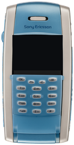</a> <b>P800</b> Sony Ericsson · 2002</td><td align="center" width="25%"><a href="../../phones/sony-ericsson/p900/">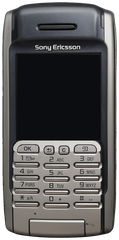</a> <b>P900</b> Sony Ericsson · 2003</td><td align="center" width="25%"><a href="../../phones/sony-ericsson/z1010/">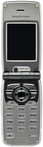</a> <b>Z1010</b> Sony Ericsson · 2003</td><td align="center" width="25%"><a href="../../phones/sony-ericsson/z200/">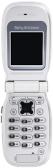</a> <b>Z200</b> Sony Ericsson · 2003</td></tr>
<tr><td align="center" width="25%"><a href="../../phones/sony-ericsson/z600/">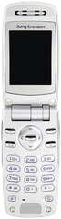</a> <b>Z600</b> Sony Ericsson · 2003</td><td align="center" width="25%"><a href="../../phones/sony-ericsson/p910i/">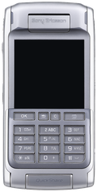</a> <b>P910i</b> Sony Ericsson · 2004</td><td align="center" width="25%"><a href="../../phones/sony-ericsson/z500a/">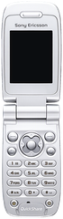</a> <b>Z500a</b> Sony Ericsson · 2004</td><td align="center" width="25%"><a href="../../phones/sony-ericsson/p990i/">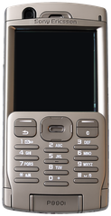</a> <b>P990i</b> Sony Ericsson · 2005</td></tr>
<tr><td align="center" width="25%"><a href="../../phones/sony-ericsson/s600i/">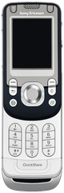</a> <b>S600i</b> Sony Ericsson · 2005</td><td align="center" width="25%"><a href="../../phones/sony-ericsson/z300i/">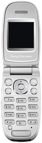</a> <b>Z300i</b> Sony Ericsson · 2005</td><td align="center" width="25%"><a href="../../phones/sony-ericsson/z520i/">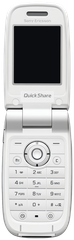</a> <b>Z520i</b> Sony Ericsson · 2005</td><td align="center" width="25%"><a href="../../phones/sony-ericsson/z800i/">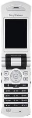</a> <b>Z800i</b> Sony Ericsson · 2005</td></tr>
<tr><td align="center" width="25%"><a href="../../phones/sony-ericsson/w300i/">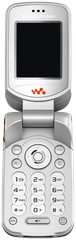</a> <b>W300i</b> Sony Ericsson · 2006</td><td align="center" width="25%"><a href="../../phones/sony-ericsson/w710i/">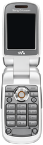</a> <b>W710i</b> Sony Ericsson · 2006</td><td align="center" width="25%"><a href="../../phones/sony-ericsson/z310i/">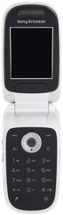</a> <b>Z310i</b> Sony Ericsson · 2006</td><td align="center" width="25%"><a href="../../phones/sony-ericsson/z525a/">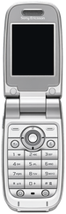</a> <b>Z525a</b> Sony Ericsson · 2006</td></tr>
<tr><td align="center" width="25%"><a href="../../phones/sony-ericsson/z530i/">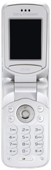</a> <b>Z530i</b> Sony Ericsson · 2006</td><td align="center" width="25%"><a href="../../phones/sony-ericsson/z550i/">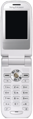</a> <b>Z550i</b> Sony Ericsson · 2006</td><td align="center" width="25%"><a href="../../phones/sony-ericsson/z558i/">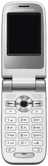</a> <b>Z558i</b> Sony Ericsson · 2006</td><td align="center" width="25%"><a href="../../phones/sony-ericsson/z610i/">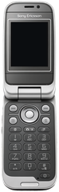</a> <b>Z610i</b> Sony Ericsson · 2006</td></tr>
<tr><td align="center" width="25%"><a href="../../phones/sony-ericsson/z710i/">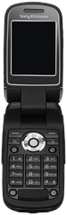</a> <b>Z710i</b> Sony Ericsson · 2006</td><td align="center" width="25%"><a href="../../phones/sony-ericsson/w380i/">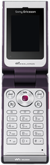</a> <b>W380i</b> Sony Ericsson · 2007</td><td align="center" width="25%"><a href="../../phones/sony-ericsson/z250i/">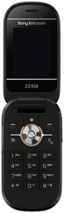</a> <b>Z250i</b> Sony Ericsson · 2007</td><td align="center" width="25%"><a href="../../phones/sony-ericsson/z320i/">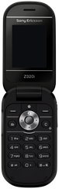</a> <b>Z320i</b> Sony Ericsson · 2007</td></tr>
<tr><td align="center" width="25%"><a href="../../phones/sony-ericsson/z750i/">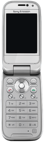</a> <b>Z750i</b> Sony Ericsson · 2007</td><td align="center" width="25%"> <b>R306 Radio</b> Sony Ericsson · 2008</td><td align="center" width="25%"><a href="../../phones/sony-ericsson/w350i/">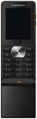</a> <b>W350i</b> Sony Ericsson · 2008</td><td align="center" width="25%"> <b>W980i</b> Sony Ericsson · 2008</td></tr>
<tr><td align="center" width="25%"><a href="../../phones/sony-ericsson/z555i/">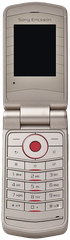</a> <b>Z555i</b> Sony Ericsson · 2008</td><td align="center" width="25%"><a href="../../phones/sony-ericsson/z770i/">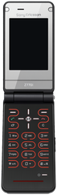</a> <b>Z770i</b> Sony Ericsson · 2008</td><td align="center" width="25%"><a href="../../phones/sony-ericsson/z780i/">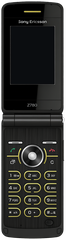</a> <b>Z780i</b> Sony Ericsson · 2008</td><td align="center" width="25%"><a href="../../phones/sony-ericsson/jalou/">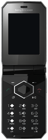</a> <b>Jalou</b> Sony Ericsson · 2009</td></tr>
<tr><td align="center" width="25%"><a href="../../phones/sony-ericsson/t707/">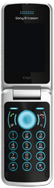</a> <b>T707</b> Sony Ericsson · 2009</td><td align="center" width="25%"><a href="../../phones/sony-ericsson/w508/">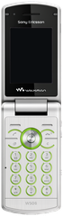</a> <b>W508</b> Sony Ericsson · 2009</td></tr>
</table>
