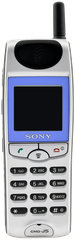
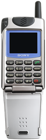

<!-- generated by tools/klapka.py pages: do not edit by hand -->
# 2000

<a href="../years.md">By year</a> · <a href="../brands.md">By brand</a> · <a href="../types.md">By type</a> · <a href="../all.md">All phones</a>

[← 1999](1999.md) · [2001 →](2001.md)

3 phones.

<table>
<tr><td align="center" width="25%"> <b>CMD-CD5</b> Sony · 2000</td><td align="center" width="25%"> <b>CMD-J5</b> Sony · 2000</td><td align="center" width="25%"> <b>CMD-Z5</b> Sony · 2000</td></tr>
</table>
