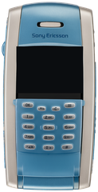
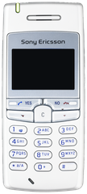
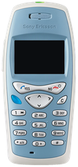
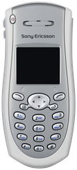
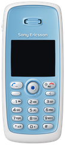
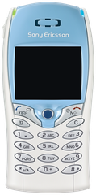

<!-- generated by tools/klapka.py pages: do not edit by hand -->
# 2002

<a href="../years.md">By year</a> · <a href="../brands.md">By brand</a> · <a href="../types.md">By type</a> · <a href="../all.md">All phones</a>

[2003 →](2003.md)

6 phones.

<table>
<tr><td align="center" width="25%"> <b>P800</b> Sony Ericsson · 2002</td><td align="center" width="25%"> <b>T100</b> Sony Ericsson · 2002</td><td align="center" width="25%"> <b>T200</b> Sony Ericsson · 2002</td><td align="center" width="25%"> <b>T206</b> Sony Ericsson · 2002</td></tr>
<tr><td align="center" width="25%"> <b>T300</b> Sony Ericsson · 2002</td><td align="center" width="25%"> <b>T68i</b> Sony Ericsson · 2002</td></tr>
</table>
