<!-- generated by tools/klapka.py pages: do not edit by hand -->
# 2005

<a href="../years.md">By year</a> · <a href="../brands.md">By brand</a> · <a href="../types.md">By type</a> · <a href="../all.md">All phones</a>

[← 2004](2004.md) · [2006 →](2006.md)

16 phones.

<table>
<tr><td align="center" width="25%"><a href="../../phones/sony-ericsson/j210i/">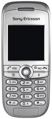</a> <b>J210i</b> Sony Ericsson · 2005</td><td align="center" width="25%"><a href="../../phones/sony-ericsson/j220i/">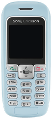</a> <b>J220i</b> Sony Ericsson · 2005</td><td align="center" width="25%"><a href="../../phones/sony-ericsson/j230i/">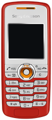</a> <b>J230i</b> Sony Ericsson · 2005</td><td align="center" width="25%"><a href="../../phones/sony-ericsson/j300i/">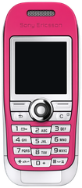</a> <b>J300i</b> Sony Ericsson · 2005</td></tr>
<tr><td align="center" width="25%"><a href="../../phones/sony-ericsson/k300i/">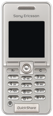</a> <b>K300i</b> Sony Ericsson · 2005</td><td align="center" width="25%"><a href="../../phones/sony-ericsson/k600i/">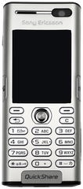</a> <b>K600i</b> Sony Ericsson · 2005</td><td align="center" width="25%"><a href="../../phones/sony-ericsson/k750i/">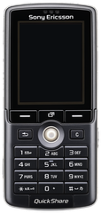</a> <b>K750i</b> Sony Ericsson · 2005</td><td align="center" width="25%"><a href="../../phones/sony-ericsson/p990i/">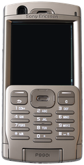</a> <b>P990i</b> Sony Ericsson · 2005</td></tr>
<tr><td align="center" width="25%"><a href="../../phones/sony-ericsson/s600i/">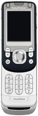</a> <b>S600i</b> Sony Ericsson · 2005</td><td align="center" width="25%"><a href="../../phones/sony-ericsson/s710a/">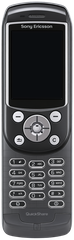</a> <b>S710a</b> Sony Ericsson · 2005</td><td align="center" width="25%"><a href="../../phones/sony-ericsson/w550i/">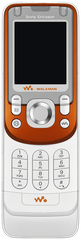</a> <b>W550i</b> Sony Ericsson · 2005</td><td align="center" width="25%"><a href="../../phones/sony-ericsson/w800i/">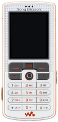</a> <b>W800i</b> Sony Ericsson · 2005</td></tr>
<tr><td align="center" width="25%"><a href="../../phones/sony-ericsson/w900i/">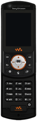</a> <b>W900i</b> Sony Ericsson · 2005</td><td align="center" width="25%"><a href="../../phones/sony-ericsson/z300i/">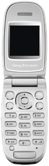</a> <b>Z300i</b> Sony Ericsson · 2005</td><td align="center" width="25%"><a href="../../phones/sony-ericsson/z520i/">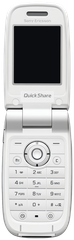</a> <b>Z520i</b> Sony Ericsson · 2005</td><td align="center" width="25%"><a href="../../phones/sony-ericsson/z800i/">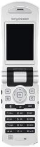</a> <b>Z800i</b> Sony Ericsson · 2005</td></tr>
</table>
