<!-- generated by tools/klapka.py pages: do not edit by hand -->
# 2008

<a href="../years.md">By year</a> · <a href="../brands.md">By brand</a> · <a href="../types.md">By type</a> · <a href="../all.md">All phones</a>

[← 2007](2007.md) · [2009 →](2009.md)

16 phones.

<table>
<tr><td align="center" width="25%"><a href="../../phones/sony-ericsson/c702/">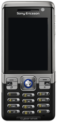</a> <b>C702</b> Sony Ericsson · 2008</td><td align="center" width="25%"><a href="../../phones/sony-ericsson/c902/">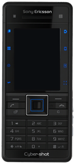</a> <b>C902</b> Sony Ericsson · 2008</td><td align="center" width="25%"><a href="../../phones/sony-ericsson/c905/">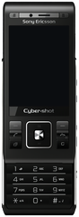</a> <b>C905</b> Sony Ericsson · 2008</td><td align="center" width="25%"><a href="../../phones/sony-ericsson/k330i/">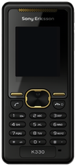</a> <b>K330</b> Sony Ericsson · 2008</td></tr>
<tr><td align="center" width="25%"><a href="../../phones/sony-ericsson/k660i/">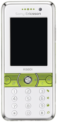</a> <b>K660i</b> Sony Ericsson · 2008</td><td align="center" width="25%"><a href="../../phones/sony-ericsson/t270i/">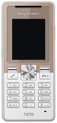</a> <b>T270i</b> Sony Ericsson · 2008</td><td align="center" width="25%"><a href="../../phones/sony-ericsson/t280i/">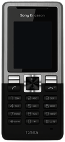</a> <b>T280i</b> Sony Ericsson · 2008</td><td align="center" width="25%"><a href="../../phones/sony-ericsson/t303/">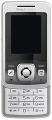</a> <b>T303</b> Sony Ericsson · 2008</td></tr>
<tr><td align="center" width="25%"><a href="../../phones/sony-ericsson/t700/">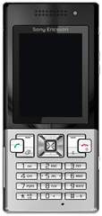</a> <b>T700</b> Sony Ericsson · 2008</td><td align="center" width="25%"><a href="../../phones/sony-ericsson/w302/">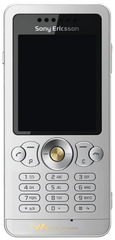</a> <b>W302</b> Sony Ericsson · 2008</td><td align="center" width="25%"><a href="../../phones/sony-ericsson/w350i/">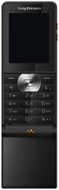</a> <b>W350i</b> Sony Ericsson · 2008</td><td align="center" width="25%"><a href="../../phones/sony-ericsson/w595/">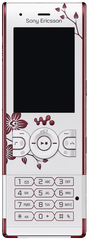</a> <b>W595</b> Sony Ericsson · 2008</td></tr>
<tr><td align="center" width="25%"><a href="../../phones/sony-ericsson/w760i/">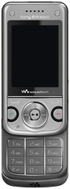</a> <b>W760i</b> Sony Ericsson · 2008</td><td align="center" width="25%"><a href="../../phones/sony-ericsson/w890i/">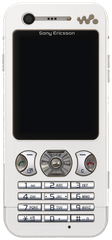</a> <b>W890i</b> Sony Ericsson · 2008</td><td align="center" width="25%"><a href="../../phones/sony-ericsson/w902/">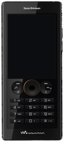</a> <b>W902</b> Sony Ericsson · 2008</td><td align="center" width="25%"> <b>W980i</b> Sony Ericsson · 2008</td></tr>
</table>
