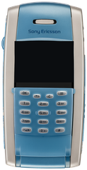
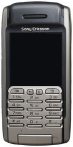
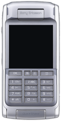
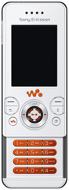
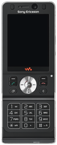
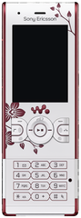

<!-- generated by tools/klapka.py pages: do not edit by hand -->
# Sony Ericsson

<a href="../../catalog/years.md">By year</a> · <a href="../../catalog/brands.md">By brand</a> · <a href="../../catalog/types.md">By type</a> · <a href="../../catalog/all.md">All phones</a>

40 phones, oldest first. Click one to see and download it.

<table>
<tr><td align="center" width="25%"> <b>P800</b> Sony Ericsson · 2002</td><td align="center" width="25%"> <b>P900</b> Sony Ericsson · 2003</td><td align="center" width="25%"> <b>T610</b> Sony Ericsson · 2003</td><td align="center" width="25%"> <b>K500i</b> Sony Ericsson · 2004</td></tr>
<tr><td align="center" width="25%"> <b>K700i</b> Sony Ericsson · 2004</td><td align="center" width="25%"> <b>P910i</b> Sony Ericsson · 2004</td><td align="center" width="25%"> <b>K300i</b> Sony Ericsson · 2005</td><td align="center" width="25%"> <b>K600i</b> Sony Ericsson · 2005</td></tr>
<tr><td align="center" width="25%"> <b>K750i</b> Sony Ericsson · 2005</td><td align="center" width="25%"> <b>P990i</b> Sony Ericsson · 2005</td><td align="center" width="25%"> <b>W550i</b> Sony Ericsson · 2005</td><td align="center" width="25%"> <b>W800i</b> Sony Ericsson · 2005</td></tr>
<tr><td align="center" width="25%"> <b>W900i</b> Sony Ericsson · 2005</td><td align="center" width="25%"> <b>K310i</b> Sony Ericsson · 2006</td><td align="center" width="25%"> <b>K510i</b> Sony Ericsson · 2006</td><td align="center" width="25%"> <b>K610i</b> Sony Ericsson · 2006</td></tr>
<tr><td align="center" width="25%"> <b>K800i</b> Sony Ericsson · 2006</td><td align="center" width="25%"> <b>W300i</b> Sony Ericsson · 2006</td><td align="center" width="25%"> <b>W810i</b> Sony Ericsson · 2006</td><td align="center" width="25%"> <b>W850i</b> Sony Ericsson · 2006</td></tr>
<tr><td align="center" width="25%"> <b>K200i</b> Sony Ericsson · 2007</td><td align="center" width="25%"> <b>K220i</b> Sony Ericsson · 2007</td><td align="center" width="25%"> <b>K320i</b> Sony Ericsson · 2007</td><td align="center" width="25%"> <b>K530i</b> Sony Ericsson · 2007</td></tr>
<tr><td align="center" width="25%"> <b>K550i</b> Sony Ericsson · 2007</td><td align="center" width="25%"> <b>K630i</b> Sony Ericsson · 2007</td><td align="center" width="25%"> <b>K770i</b> Sony Ericsson · 2007</td><td align="center" width="25%"> <b>K810i</b> Sony Ericsson · 2007</td></tr>
<tr><td align="center" width="25%"> <b>K850i</b> Sony Ericsson · 2007</td><td align="center" width="25%"> <b>P1i</b> Sony Ericsson · 2007</td><td align="center" width="25%"> <b>W200i</b> Sony Ericsson · 2007</td><td align="center" width="25%"> <b>W580i</b> Sony Ericsson · 2007</td></tr>
<tr><td align="center" width="25%"> <b>W610i</b> Sony Ericsson · 2007</td><td align="center" width="25%"> <b>W880i</b> Sony Ericsson · 2007</td><td align="center" width="25%"> <b>W910i</b> Sony Ericsson · 2007</td><td align="center" width="25%"> <b>K330</b> Sony Ericsson · 2008</td></tr>
<tr><td align="center" width="25%"> <b>K660i</b> Sony Ericsson · 2008</td><td align="center" width="25%"> <b>W595</b> Sony Ericsson · 2008</td><td align="center" width="25%"> <b>W890i</b> Sony Ericsson · 2008</td><td align="center" width="25%"> <b>W995</b> Sony Ericsson · 2009</td></tr>
</table>
