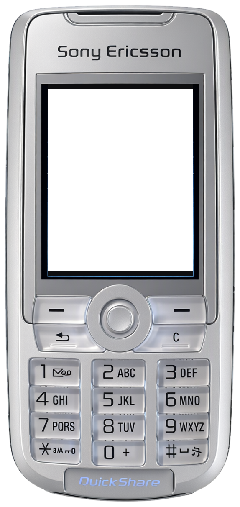
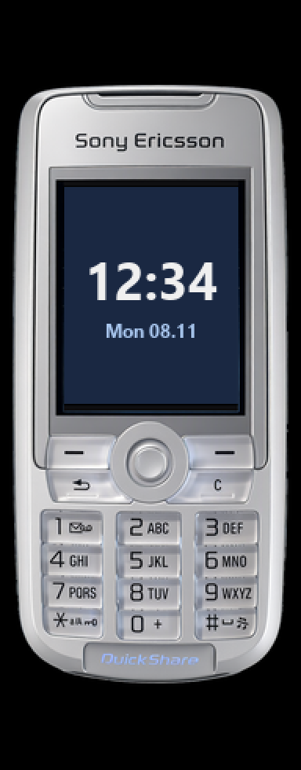

<!-- generated by tools/klapka.py pages: edit phone.json / build.json instead -->
# Sony Ericsson K700i

  
  &nbsp;&nbsp;
  

| | |
|---|---|
| Year | 2004 |
| Type | candybar |
| Size | 46 × 99 mm |
| Display | 1.8″, 176 × 220 |
| Screen hole in `skin.png` | x 114, y 213, 348 × 435 px |

## Download

Click **Download**; the file saves straight away.

| File | What it is | |
|---|---|---|
| `skin.png` | the phone at 12 px/mm, transparent background, transparent screen | [Download](skin.png?raw=true) |
| `body.png` | the same without the screen hole | [Download](body.png?raw=true) |
| `mi-band-192x490.png` | ready for a Mi Band 7 / 8 / 9 watch face (192 × 490) | [Download](mi-band-192x490.png?raw=true) |
| `phone.json` | sizes and the screen position, for your own tools | [Download](phone.json?raw=true) |

**Mi Band 7 / 8 / 9:** use `mi-band-192x490.png` as the background and put the clock inside
the screen: x 41, y 119, 111 × 138 px.

## How it was made

Standard v1 ([docs/PIPELINE.md](../../../docs/PIPELINE.md)): measured to scale, re-rendered straight
and clean from a photo, every printed label checked.
Body aspect 0.4632 (spec 0.4646), screen at the exact 176:220 aspect.

**Credits:** appearance from a [photo](https://commons.wikimedia.org/wiki/File:Sony_Ericsson_K700i_2.JPG) by J Di at English Wikipedia, Public domain; geometry measured on a [photo](https://www.phonescoop.com/phones/photos.php?p=498) by Sony Ericsson, press image (measured only, not used for appearance); specs: [phonescoop.com](https://phonescoop.com/phones/phone.php?p=498), [gsmarena.com](https://m.gsmarena.com/phone692.php), [teltarif.de](https://www.teltarif.de/handy/sony-ericsson/k700i/).

Trademarks belong to their owners. KLAPKA is a fan project and is not affiliated with any phone maker.
