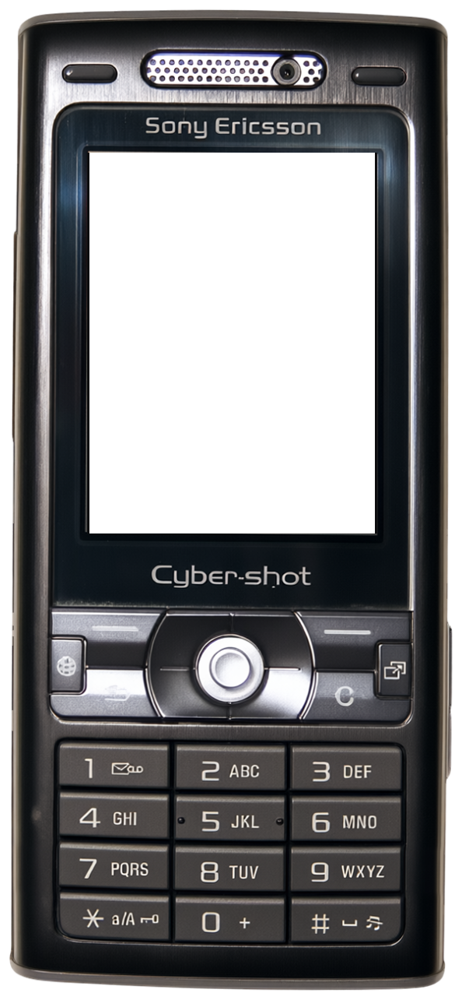
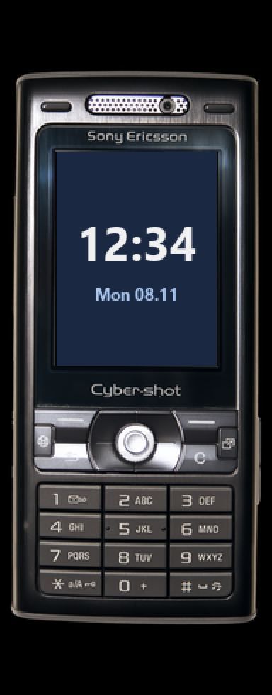

<!-- generated by tools/klapka.py pages: edit phone.json / build.json instead -->
# Sony Ericsson K800i

  
  &nbsp;&nbsp;
  

| | |
|---|---|
| Year | 2006 |
| Type | candybar |
| Size | 47 × 105 mm |
| Display | 2.0″, 240 × 320 |
| Screen hole in `skin.png` | x 115, y 196, 367 × 489 px |

## Download

Click **Download**; the file saves straight away.

| File | What it is | |
|---|---|---|
| `skin.png` | the phone at 12 px/mm, transparent background, transparent screen | [Download](skin.png?raw=true) |
| `body.png` | the same without the screen hole | [Download](body.png?raw=true) |
| `mi-band-192x490.png` | ready for a Mi Band 7 / 8 / 9 watch face (192 × 490) | [Download](mi-band-192x490.png?raw=true) |
| `phone.json` | sizes and the screen position, for your own tools | [Download](phone.json?raw=true) |

**Mi Band 7 / 8 / 9:** use `mi-band-192x490.png` as the background and put the clock inside
the screen: x 40, y 107, 113 × 151 px.

## How it was made

Standard v1 ([docs/PIPELINE.md](../../../docs/PIPELINE.md)): measured to scale, re-rendered straight
and clean from a photo, every printed label checked.
Body aspect 0.4526 (spec 0.4476), screen at the exact 240:320 aspect.

**Credits:** appearance from a [photo](https://commons.wikimedia.org/wiki/File:SE_K800i_2.jpg), Public domain; geometry measured on a [photo](https://commons.wikimedia.org/wiki/File:SE_K800i_2.jpg), Public domain; specs: [gsmarena.com](https://m.gsmarena.com/sony_ericsson_k800-1485.php), [en.wikipedia.org](https://en.wikipedia.org/wiki/Sony_Ericsson_K800i).

Trademarks belong to their owners. KLAPKA is a fan project and is not affiliated with any phone maker.
