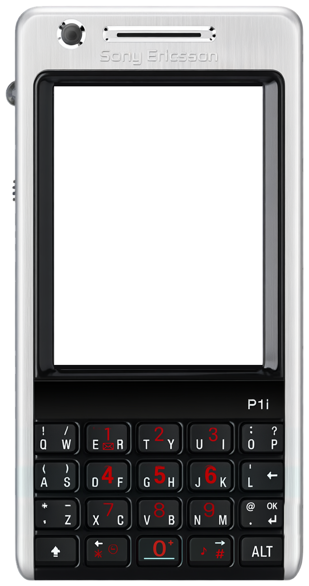
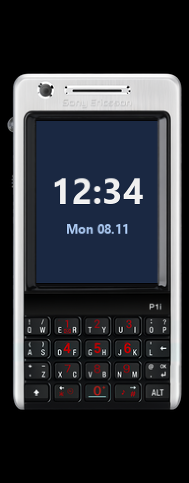

<!-- generated by tools/klapka.py pages: edit phone.json / build.json instead -->

<a href="../../../">KLAPKA</a> · <a href="../../../catalog/years/2007.md">2007</a> · <a href="../">Sony Ericsson</a> · <a href="../../../catalog/types/candybar.md">Candybar</a>

# Sony Ericsson P1i

  
  &nbsp;&nbsp;
  

| | |
|---|---|
| Year | 2007 |
| Type | candybar |
| Size | 55 × 106 mm |
| Display | 2.6″, 240 × 320 |
| Screen hole in `skin.png` | x 120, y 191, 462 × 616 px |

## Download

Click **Download**; the file saves straight away.

| File | What it is | |
|---|---|---|
| `skin.png` | the phone at 12 px/mm, transparent background, transparent screen | [Download](skin.png?raw=true) |
| `body.png` | the same without the screen hole | [Download](body.png?raw=true) |
| `mi-band-192x490.png` | ready for a Mi Band 7 / 8 / 9 watch face (192 × 490) | [Download](mi-band-192x490.png?raw=true) |
| `phone.json` | sizes and the screen position, for your own tools | [Download](phone.json?raw=true) |

**Mi Band 7 / 8 / 9:** use `mi-band-192x490.png` as the background and put the clock inside
the screen: x 37, y 123, 123 × 164 px.

## How it was made

Standard v1 ([docs/PIPELINE.md](../../../docs/PIPELINE.md)): measured to scale, re-rendered straight
and clean from a photo, every printed label checked.
Body aspect 0.5199 (spec 0.5189), screen at the exact 240:320 aspect.

**Credits:** appearance from a [photo](https://image.ceneostatic.pl/data/products/786175/f61cf1cf-57cd-4ce3-830d-f9c5ae144f27_i-sony-ericsson-p1i-srebrny.jpg (press render, via Koks)); geometry measured on a [photo](https://image.ceneostatic.pl/data/products/786175/f61cf1cf-57cd-4ce3-830d-f9c5ae144f27_i-sony-ericsson-p1i-srebrny.jpg); specs: [wikiwand.com](https://wikiwand.com/EN/SONY_ERICSSON_P1i), [productindetail.com](https://www.productindetail.com/pm/sony-ericsson-p1i).

Trademarks belong to their owners. KLAPKA is a fan project and is not affiliated with any phone maker.
