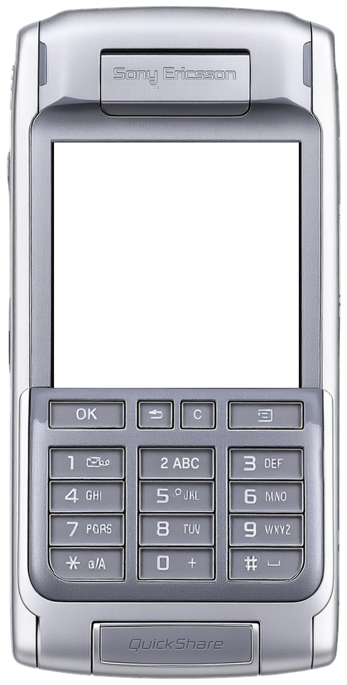
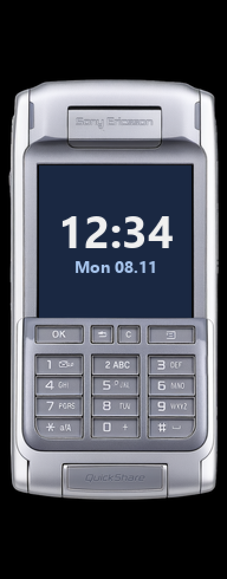

<!-- generated by tools/klapka.py pages: edit phone.json / build.json instead -->

<a href="../../../">KLAPKA</a> · <a href="../../../catalog/years/2004.md">2004</a> · <a href="../">Sony Ericsson</a> · <a href="../../../catalog/types/flip.md">Flip / clamshell</a>

# Sony Ericsson P910i

  
  &nbsp;&nbsp;
  

| | |
|---|---|
| Year | 2004 |
| Type | flip, shown closed |
| Size | 57 × 115 mm (closed) |
| Display | 2.227″, 208 × 208 |
| Screen hole in `skin.png` | x 111, y 292, 503 × 503 px |

## Download

Click **Download**; the file saves straight away.

| File | What it is | |
|---|---|---|
| `skin.png` | the phone at 12 px/mm, transparent background, transparent screen | [Download](skin.png?raw=true) |
| `body.png` | the same without the screen hole | [Download](body.png?raw=true) |
| `mi-band-192x490.png` | ready for a Mi Band 7 / 8 / 9 watch face (192 × 490) | [Download](mi-band-192x490.png?raw=true) |
| `phone.json` | sizes and the screen position, for your own tools | [Download](phone.json?raw=true) |

**Mi Band 7 / 8 / 9:** use `mi-band-192x490.png` as the background and put the clock inside
the screen: x 33, y 140, 129 × 129 px.

## How it was made

Standard v1 ([docs/PIPELINE.md](../../../docs/PIPELINE.md)): measured to scale, re-rendered straight
and clean from a photo, every printed label checked.
Body aspect 0.499 (spec 0.4957), screen at the exact 208:208 aspect.

**Credits:** appearance from a [photo](https://commons.wikimedia.org/wiki/File:Sony_Ericsson_P910i_-_Front_(Closed).jpg) by Beamish4, CC BY-SA 4.0; geometry measured on a [photo](https://commons.wikimedia.org/wiki/File:Sony_Ericsson_P900.png) by GtrxAC, CC BY-SA 4.0; specs: [manualsdir.com](https://www.manualsdir.com/manuals/149794/sony-ericsson-p910i.html?page=197), [gsmarena.com](https://m.gsmarena.com/sony_ericsson_p910-846.php).

Trademarks belong to their owners. KLAPKA is a fan project and is not affiliated with any phone maker.
