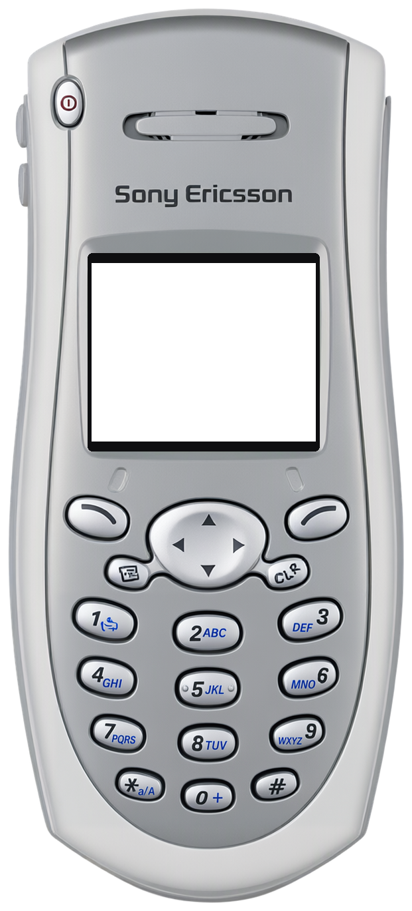
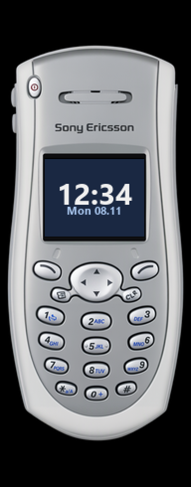

<!-- generated by tools/klapka.py pages: edit phone.json / build.json instead -->

<a href="../../../">KLAPKA</a> · <a href="../../../catalog/years/2002.md">2002</a> · <a href="../">Sony Ericsson</a> · <a href="../../../catalog/types/candybar.md">Candybar</a>

# Sony Ericsson T206

  
  &nbsp;&nbsp;
  

| | |
|---|---|
| Year | 2002 |
| Type | candybar |
| Size | 48 × 112 mm |
| Display | 1.31″, 101 × 80 |
| Screen hole in `skin.png` | x 138, y 395, 338 × 268 px |

## Download

Click **Download**; the file saves straight away.

| File | What it is | |
|---|---|---|
| `skin.png` | the phone at 12 px/mm, transparent background, transparent screen | [Download](skin.png?raw=true) |
| `skin-black.png` | the same on a black background, only the screen transparent (for apps that do not accept a transparent background) | [Download](skin-black.png?raw=true) |
| `body.png` | the same without the screen hole | [Download](body.png?raw=true) |
| `mi-band-192x490.png` | ready for a Mi Band 7 / 8 / 9 watch face (192 × 490) | [Download](mi-band-192x490.png?raw=true) |
| `phone.json` | sizes and the screen position, for your own tools | [Download](phone.json?raw=true) |

**Mi Band 7 / 8 / 9:** use `mi-band-192x490.png` as the background and put the clock inside
the screen: x 45, y 160, 100 × 78 px.

## How it was made

Standard v1 ([docs/PIPELINE.md](../../../docs/PIPELINE.md)): measured to scale, re-rendered straight
and clean from a photo, every printed label checked.
Body aspect 0.444 (spec 0.4286), screen at the exact 101:80 aspect.

**Credits:** appearance from a [photo](https://img.mobilephonefeatures.com/phone/view_b/sony_ericsson_t206_f677f9b584.jpg (press render, link from Koks)); geometry measured on a [photo](https://img.mobilephonefeatures.com/phone/view_b/sony_ericsson_t206_f677f9b584.jpg); specs: [phonescoop.com](https://www.phonescoop.com/phones/phone.php?p=118), [sogi.com.tw](https://www.sogi.com.tw/products/Sony_Ericsson_T206/370), [lpcwiki.miraheze.org](https://lpcwiki.miraheze.org/wiki/Sony_Ericsson_T206).

Trademarks belong to their owners. KLAPKA is a fan project and is not affiliated with any phone maker.
