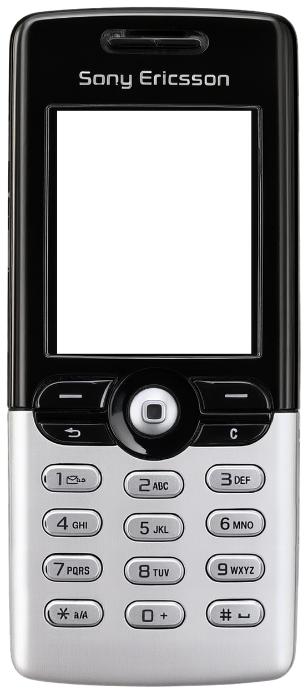
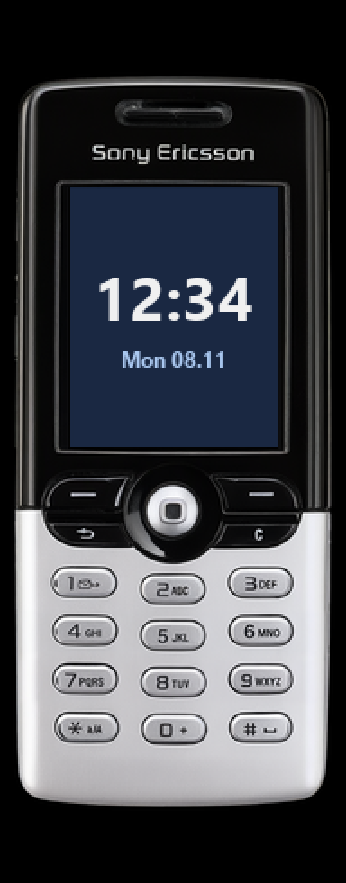

<!-- generated by tools/klapka.py pages: edit phone.json / build.json instead -->
# Sony Ericsson T610

  
  &nbsp;&nbsp;
  

| | |
|---|---|
| Year | 2003 |
| Type | candybar |
| Size | 44 × 102 mm |
| Display | 1.8″, 128 × 160 |
| Screen hole in `skin.png` | x 103, y 199, 350 × 437 px |

## Download

Click **Download**; the file saves straight away.

| File | What it is | |
|---|---|---|
| `skin.png` | the phone at 12 px/mm, transparent background, transparent screen | [Download](skin.png?raw=true) |
| `body.png` | the same without the screen hole | [Download](body.png?raw=true) |
| `mi-band-192x490.png` | ready for a Mi Band 7 / 8 / 9 watch face (192 × 490) | [Download](mi-band-192x490.png?raw=true) |
| `phone.json` | sizes and the screen position, for your own tools | [Download](phone.json?raw=true) |

**Mi Band 7 / 8 / 9:** use `mi-band-192x490.png` as the background and put the clock inside
the screen: x 39, y 104, 115 × 144 px.

## How it was made

Standard v1 ([docs/PIPELINE.md](../../../docs/PIPELINE.md)): measured to scale, re-rendered straight
and clean from a photo, every printed label checked.
Body aspect 0.4336 (spec 0.4314), screen at the exact 128:160 aspect.

**Credits:** appearance from a [photo](https://commons.wikimedia.org/wiki/File:Sony_Ericsson_T610_(Aluminium_Haze)_-_Front.jpg) by Beamish4, CC BY-SA 4.0; geometry measured on a [photo](https://commons.wikimedia.org/wiki/File:SonyEricsson_T610_AluminumHaze_front.jpg) by Episteme, Public domain; specs: [en.wikipedia.org](https://en.wikipedia.org/wiki/Sony_Ericsson_T610), [teltarif.de](https://www.teltarif.de/h/sony-ericsson/t610/).

Trademarks belong to their owners. KLAPKA is a fan project and is not affiliated with any phone maker.
