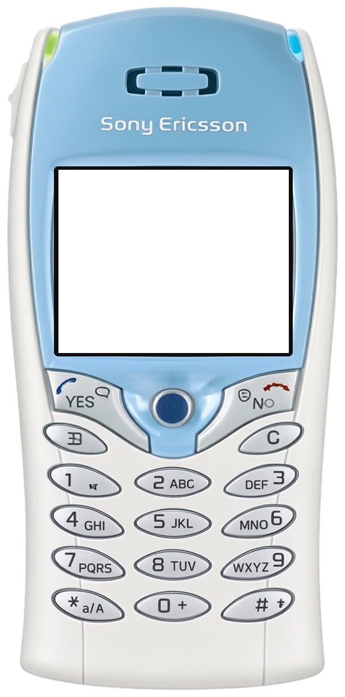
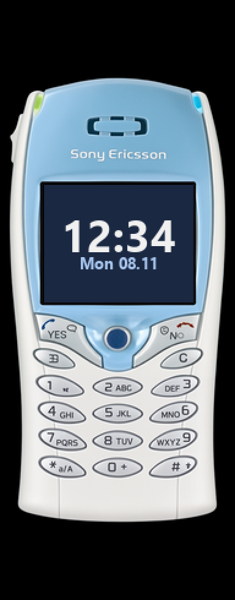

<!-- generated by tools/klapka.py pages: edit phone.json / build.json instead -->

<a href="../../../">KLAPKA</a> · <a href="../../../catalog/years/2002.md">2002</a> · <a href="../">Sony Ericsson</a> · <a href="../../../catalog/types/candybar.md">Candybar</a>

# Sony Ericsson T68i

  
  &nbsp;&nbsp;
  

| | |
|---|---|
| Year | 2002 |
| Type | candybar |
| Size | 48 × 101 mm |
| Display | 1.6″, 101 × 80 |
| Screen hole in `skin.png` | x 104, y 301, 410 × 325 px |

## Download

Click **Download**; the file saves straight away.

| File | What it is | |
|---|---|---|
| `skin.png` | the phone at 12 px/mm, transparent background, transparent screen | [Download](skin.png?raw=true) |
| `body.png` | the same without the screen hole | [Download](body.png?raw=true) |
| `mi-band-192x490.png` | ready for a Mi Band 7 / 8 / 9 watch face (192 × 490) | [Download](mi-band-192x490.png?raw=true) |
| `phone.json` | sizes and the screen position, for your own tools | [Download](phone.json?raw=true) |

**Mi Band 7 / 8 / 9:** use `mi-band-192x490.png` as the background and put the clock inside
the screen: x 36, y 151, 122 × 96 px.

## How it was made

Standard v1 ([docs/PIPELINE.md](../../../docs/PIPELINE.md)): measured to scale, re-rendered straight
and clean from a photo, every printed label checked.
Body aspect 0.4864 (spec 0.4752), screen at the exact 101:80 aspect.

**Credits:** appearance from a [photo](https://cdn.komputerswiat.pl/... T68i press render (via Koks; cropped)); geometry measured on a [photo](https://cdn.komputerswiat.pl/1/dV9k9lBaHR0cHM6Ly9vY2RuLmV1L3B1bHNjbXMvTURBXy85OGY4MTBmOGExNzU5ZTk1YzgxNzFjZTllNjRjODNhMi5qcGeRkwXNAtDNAeDeAAKhMAehMQQ); specs: [gsmarena.com](https://www.gsmarena.com/sony_ericsson_t68i-325.php), [phonearena.com](https://www.phonearena.com/phones/Sony-Ericsson-t68i_id131).

Trademarks belong to their owners. KLAPKA is a fan project and is not affiliated with any phone maker.
