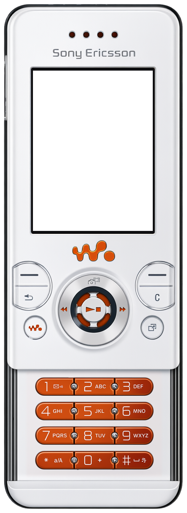
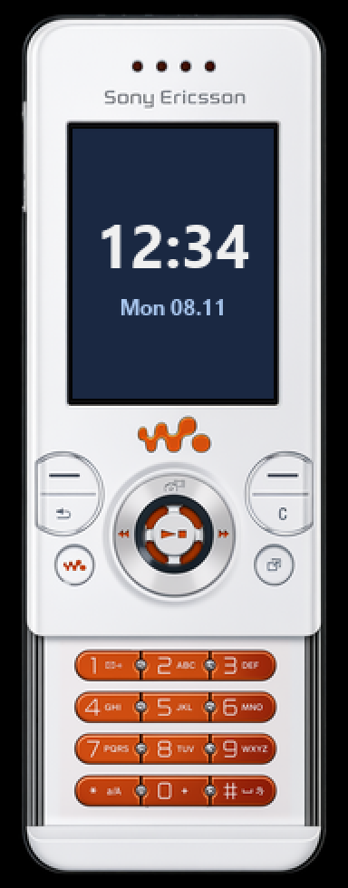

<!-- generated by tools/klapka.py pages: edit phone.json / build.json instead -->

<a href="../../../">KLAPKA</a> · <a href="../../../catalog/years/2007.md">2007</a> · <a href="../">Sony Ericsson</a> · <a href="../../../catalog/types/slider.md">Slider</a>

# Sony Ericsson W580i

  
  &nbsp;&nbsp;
  

| | |
|---|---|
| Year | 2007 |
| Type | slider, shown open |
| Size | 47 × 130 mm (open), 47 × 99 mm closed |
| Display | 2.0″, 240 × 320 |
| Screen hole in `skin.png` | x 102, y 218, 371 × 495 px |

## Download

Click **Download**; the file saves straight away.

| File | What it is | |
|---|---|---|
| `skin.png` | the phone at 12 px/mm, transparent background, transparent screen | [Download](skin.png?raw=true) |
| `body.png` | the same without the screen hole | [Download](body.png?raw=true) |
| `mi-band-192x490.png` | ready for a Mi Band 7 / 8 / 9 watch face (192 × 490) | [Download](mi-band-192x490.png?raw=true) |
| `phone.json` | sizes and the screen position, for your own tools | [Download](phone.json?raw=true) |

**Mi Band 7 / 8 / 9:** use `mi-band-192x490.png` as the background and put the clock inside
the screen: x 40, y 71, 111 × 149 px.

## How it was made

Standard v1 ([docs/PIPELINE.md](../../../docs/PIPELINE.md)): measured to scale, re-rendered straight
and clean from a photo, every printed label checked.
Body aspect 0.3555 (spec 0.3615), screen at the exact 240:320 aspect.

**Credits:** appearance from a [photo](https://cdn.cs.1worldsync.com/24/7e/247e3dae-872f-4e84-896e-a502c8dd030f.jpg (press render, via Koks; cropped to the phone)); geometry measured on a [photo](https://cdn.cs.1worldsync.com/24/7e/247e3dae-872f-4e84-896e-a502c8dd030f.jpg); specs: [teltarif.de](https://www.teltarif.de/h/sony-ericsson/w580i/), [91mobiles.com](https://www.91mobiles.com/sony-ericsson-w580i-price-in-india?ty=specs).

Trademarks belong to their owners. KLAPKA is a fan project and is not affiliated with any phone maker.
