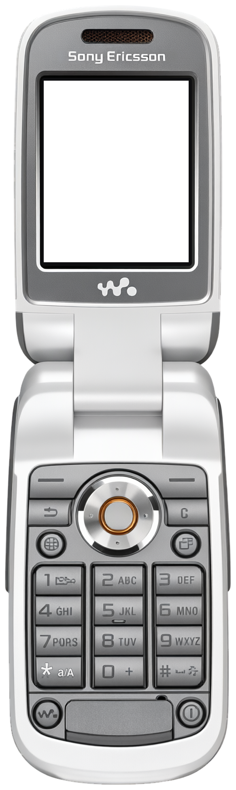
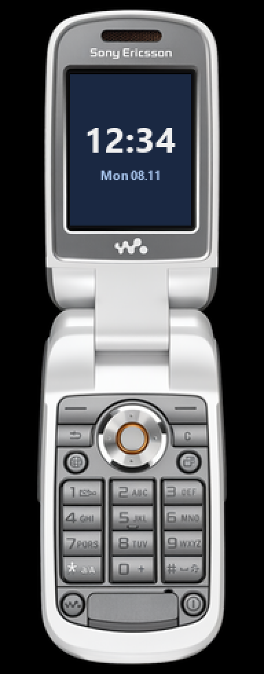

<!-- generated by tools/klapka.py pages: edit phone.json / build.json instead -->

<a href="../../../">KLAPKA</a> · <a href="../../../catalog/years/2006.md">2006</a> · <a href="../">Sony Ericsson</a> · <a href="../../../catalog/types/flip.md">Flip / clamshell</a>

# Sony Ericsson W710i

  
  &nbsp;&nbsp;
  

| | |
|---|---|
| Year | 2006 |
| Type | flip, shown open |
| Size | 48 × 160.4 mm (open), 48 × 88 mm closed |
| Display | 1.9″, 176 × 220 |
| Screen hole in `skin.png` | x 108, y 199, 358 × 448 px |

## Download

Click **Download**; the file saves straight away.

| File | What it is | |
|---|---|---|
| `skin.png` | the phone at 12 px/mm, transparent background, transparent screen | [Download](skin.png?raw=true) |
| `skin-black.png` | the same on a black background, only the screen transparent (for apps that do not accept a transparent background) | [Download](skin-black.png?raw=true) |
| `body.png` | the same without the screen hole | [Download](body.png?raw=true) |
| `mi-band-192x490.png` | ready for a Mi Band 7 / 8 / 9 watch face (192 × 490) | [Download](mi-band-192x490.png?raw=true) |
| `phone.json` | sizes and the screen position, for your own tools | [Download](phone.json?raw=true) |

**Mi Band 7 / 8 / 9:** use `mi-band-192x490.png` as the background and put the clock inside
the screen: x 51, y 54, 88 × 110 px.

## How it was made

Standard v1 ([docs/PIPELINE.md](../../../docs/PIPELINE.md)): measured to scale, re-rendered straight
and clean from a photo, every printed label checked.
Body aspect 0.2904 (spec 0.2993), screen at the exact 176:220 aspect.

**Credits:** appearance from a [photo](https://www.newmobile.com/phones/sony/ericsson-w710i (press render w710_front_open_performance_graphite; reflection cropped off)); geometry measured on a [photo](https://cdn.nieuwemobiel.nl/media/w710_front_open_performance_graphite/); specs: [teltarif.de](https://www.teltarif.de/h/sony-ericsson/w710i/).

Trademarks belong to their owners. KLAPKA is a fan project and is not affiliated with any phone maker.
