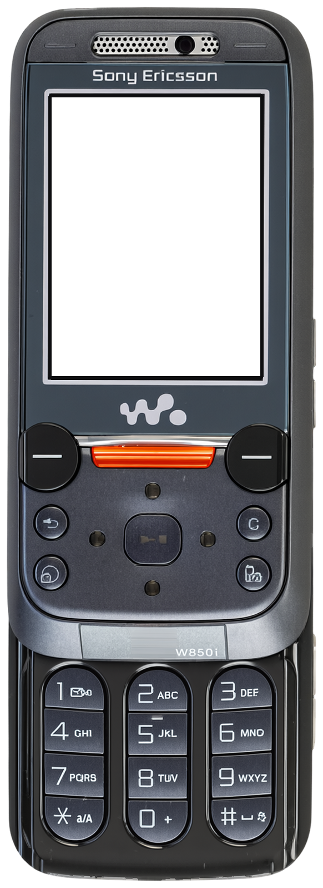
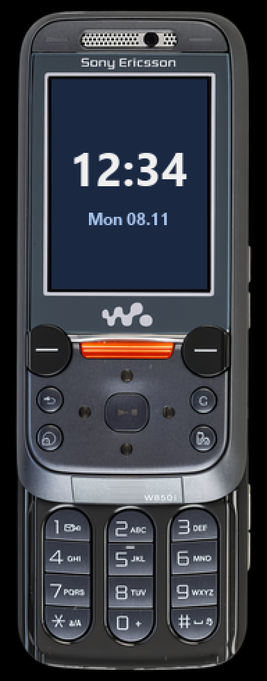

<!-- generated by tools/klapka.py pages: edit phone.json / build.json instead -->

<a href="../../../">KLAPKA</a> · <a href="../../../catalog/years/2006.md">2006</a> · <a href="../">Sony Ericsson</a> · <a href="../../../catalog/types/slider.md">Slider</a>

# Sony Ericsson W850i

  
  &nbsp;&nbsp;
  

| | |
|---|---|
| Year | 2006 |
| Type | slider, shown open |
| Size | 47 × 131.0 mm (open), 47 × 98 mm closed |
| Display | 2.0″, 240 × 320 |
| Screen hole in `skin.png` | x 93, y 175, 376 × 501 px |

## Download

Click **Download**; the file saves straight away.

| File | What it is | |
|---|---|---|
| `skin.png` | the phone at 12 px/mm, transparent background, transparent screen | [Download](skin.png?raw=true) |
| `body.png` | the same without the screen hole | [Download](body.png?raw=true) |
| `mi-band-192x490.png` | ready for a Mi Band 7 / 8 / 9 watch face (192 × 490) | [Download](mi-band-192x490.png?raw=true) |
| `phone.json` | sizes and the screen position, for your own tools | [Download](phone.json?raw=true) |

**Mi Band 7 / 8 / 9:** use `mi-band-192x490.png` as the background and put the clock inside
the screen: x 37, y 57, 112 × 151 px.

## How it was made

Standard v1 ([docs/PIPELINE.md](../../../docs/PIPELINE.md)): measured to scale, re-rendered straight
and clean from a photo, every printed label checked.
Body aspect 0.3552 (spec 0.3588), screen at the exact 240:320 aspect.

**Credits:** appearance from a [photo](https://static-mpm-optimized.s3.eu-west-2.amazonaws.com/7ff131ce-038e-4e99-8320-23abf5b20d24_large.png (via Koks; operator logo painted out)); geometry measured on a [photo](https://static-mpm-optimized.s3.eu-west-2.amazonaws.com/7ff131ce-038e-4e99-8320-23abf5b20d24_large.png); specs: [teltarif.de](https://www.teltarif.de/h/sony-ericsson/w850i/), [gsmarena.com](https://www.gsmarena.com/sony_ericsson_w850-1563.php).

Trademarks belong to their owners. KLAPKA is a fan project and is not affiliated with any phone maker.
