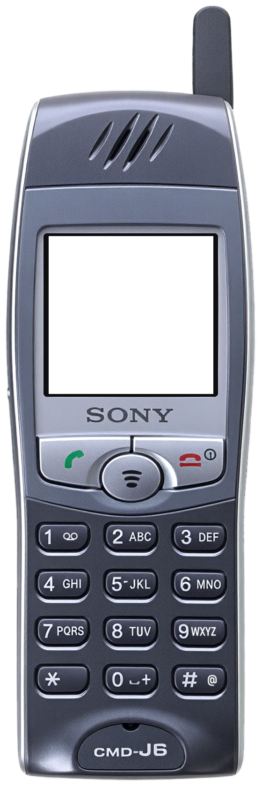
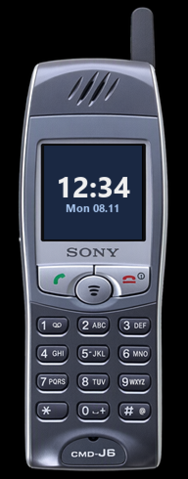

<!-- generated by tools/klapka.py pages: edit phone.json / build.json instead -->

<a href="../../../">KLAPKA</a> · <a href="../../../catalog/years/2001.md">2001</a> · <a href="../">Sony</a> · <a href="../../../catalog/types/candybar.md">Candybar</a>

# Sony CMD-J6

  
  &nbsp;&nbsp;
  

| | |
|---|---|
| Year | 2001 |
| Type | candybar |
| Size | 44 × 122 mm |
| Display | 1.55″, 96 × 92 |
| Screen hole in `skin.png` | x 104, y 504, 352 × 337 px |

## Download

Click **Download**; the file saves straight away.

| File | What it is | |
|---|---|---|
| `skin.png` | the phone at 12 px/mm, transparent background, transparent screen | [Download](skin.png?raw=true) |
| `skin-black.png` | the same on a black background, only the screen transparent (for apps that do not accept a transparent background) | [Download](skin-black.png?raw=true) |
| `body.png` | the same without the screen hole | [Download](body.png?raw=true) |
| `mi-band-192x490.png` | ready for a Mi Band 7 / 8 / 9 watch face (192 × 490) | [Download](mi-band-192x490.png?raw=true) |
| `phone.json` | sizes and the screen position, for your own tools | [Download](phone.json?raw=true) |

**Mi Band 7 / 8 / 9:** use `mi-band-192x490.png` as the background and put the clock inside
the screen: x 45, y 149, 100 × 96 px.

## How it was made

Standard v1 ([docs/PIPELINE.md](../../../docs/PIPELINE.md)): measured to scale, re-rendered straight
and clean from a photo, every printed label checked.
Body aspect 0.324 (spec 0.3188), screen at the exact 96:92 aspect.

**Credits:** appearance from a [photo](https://1gr.cz/imgs/telefony/A010824_SONYCMDJ6_N.JPG (photo of the J5 and J6 side by side, via Koks; stretched back 1.078 sideways, the J6 cropped and upscaled 3x)); geometry measured on a [photo](https://1gr.cz/imgs/telefony/A010824_SONYCMDJ6_N.JPG); specs: [gsmarena.com](https://m.gsmarena.com/sony_cmd_j6-270.php), [devicebeast.com](https://devicebeast.com/phones/cmd-j6), [gsmchoice.com](https://www.gsmchoice.com/en/catalogue/sony/cmdj6/).

Trademarks belong to their owners. KLAPKA is a fan project and is not affiliated with any phone maker.
