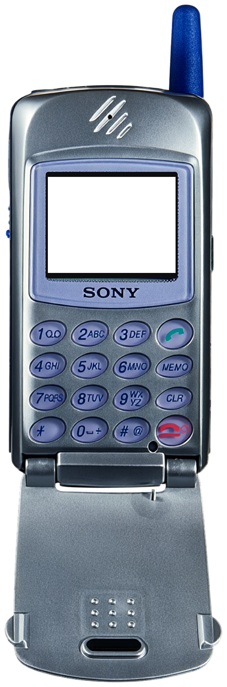
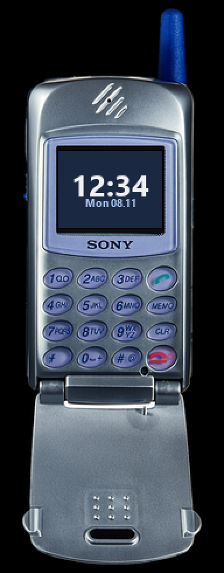

<!-- generated by tools/klapka.py pages: edit phone.json / build.json instead -->

<a href="../../../">KLAPKA</a> · <a href="../../../catalog/years/2001.md">2001</a> · <a href="../">Sony</a> · <a href="../../../catalog/types/flip.md">Flip / clamshell</a>

# Sony CMD-MZ5

  
  &nbsp;&nbsp;
  

| | |
|---|---|
| Year | 2001 |
| Type | flip, shown open |
| Size | 49.5 × 136.6 mm (open) |
| Display | 1.45″, 96 × 72 |
| Screen hole in `skin.png` | x 133, y 490, 355 × 266 px |

## Download

Click **Download**; the file saves straight away.

| File | What it is | |
|---|---|---|
| `skin.png` | the phone at 12 px/mm, transparent background, transparent screen | [Download](skin.png?raw=true) |
| `skin-black.png` | the same on a black background, only the screen transparent (for apps that do not accept a transparent background) | [Download](skin-black.png?raw=true) |
| `body.png` | the same without the screen hole | [Download](body.png?raw=true) |
| `mi-band-192x490.png` | ready for a Mi Band 7 / 8 / 9 watch face (192 × 490) | [Download](mi-band-192x490.png?raw=true) |
| `phone.json` | sizes and the screen position, for your own tools | [Download](phone.json?raw=true) |

**Mi Band 7 / 8 / 9:** use `mi-band-192x490.png` as the background and put the clock inside
the screen: x 50, y 129, 89 × 66 px.

## How it was made

Standard v1 ([docs/PIPELINE.md](../../../docs/PIPELINE.md)): measured to scale, re-rendered straight
and clean from a photo, every printed label checked.
Body aspect 0.3231 (spec 0.3161), screen at the exact 96:72 aspect.

**Credits:** appearance from a [photo](https://fdn2.gsmarena.com/vv/pics/sony/somz5_04.jpg (press render of the open phone, GSMArena; its watermark cut off, upscaled 3x and stretched 5.9% lengthwise: it is shot slightly from below, 129 mm long at 49.5 mm against 136.6 mm on the museum's straight-on shot)); geometry measured on a [photo](https://www.mobilephonemuseum.com/phone-detail/cmd-mz5) by Mobile Phone Museum; specs: [gsmarena.com](https://m.gsmarena.com/sony_cmd_mz5-232.php), [devicebeast.com](https://devicebeast.com/phones/cmd-mz5), [manualslib.com](https://www.manualslib.com/manual/652799/Sony-Cmd-Mz5.html?page=107).

Trademarks belong to their owners. KLAPKA is a fan project and is not affiliated with any phone maker.
