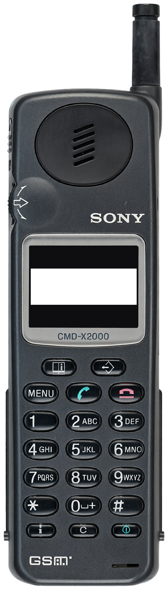
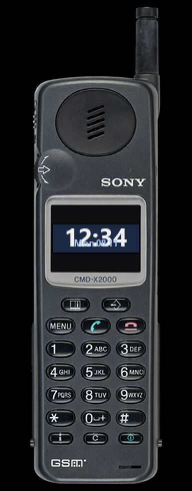

<!-- generated by tools/klapka.py pages: edit phone.json / build.json instead -->

<a href="../../../">KLAPKA</a> · <a href="../../../catalog/years/1997.md">1997</a> · <a href="../">Sony</a> · <a href="../../../catalog/types/candybar.md">Candybar</a>

# Sony CMD-X2000

  
  &nbsp;&nbsp;
  

| | |
|---|---|
| Year | 1997 |
| Type | candybar |
| Size | 46 × 142.5 mm |
| Display | 1.21″, 97 × 33 |
| Screen hole in `skin.png` | x 106, y 920, 365 × 124 px |

## Download

Click **Download**; the file saves straight away.

| File | What it is | |
|---|---|---|
| `skin.png` | the phone at 12 px/mm, transparent background, transparent screen | [Download](skin.png?raw=true) |
| `skin-black.png` | the same on a black background, only the screen transparent (for apps that do not accept a transparent background) | [Download](skin-black.png?raw=true) |
| `body.png` | the same without the screen hole | [Download](body.png?raw=true) |
| `mi-band-192x490.png` | ready for a Mi Band 7 / 8 / 9 watch face (192 × 490) | [Download](mi-band-192x490.png?raw=true) |
| `phone.json` | sizes and the screen position, for your own tools | [Download](phone.json?raw=true) |

**Mi Band 7 / 8 / 9:** use `mi-band-192x490.png` as the background and put the clock inside
the screen: x 53, y 224, 86 × 28 px.

## How it was made

Standard v1 ([docs/PIPELINE.md](../../../docs/PIPELINE.md)): measured to scale, re-rendered straight
and clean from a photo, every printed label checked.
Body aspect 0.278 (spec 0.2764), screen at the exact 97:33 aspect.

**Credits:** appearance from a [photo](https://static-mpm-optimized.s3.eu-west-2.amazonaws.com/adf1d6b0-2cf8-4400-a136-0381afcd22ef_xlarge.png (Mobile Phone Museum, phone-detail/sony-cmd-x2000; no press render found)) by Mobile Phone Museum; geometry measured on a [photo](https://www.mobilephonemuseum.com/phone-detail/sony-cmd-x2000) by Mobile Phone Museum; specs: [mobile-review.com](https://mobile-review.com/phonemodels/sony/sony-cmd-x2000.shtml), [gsmarena.com](https://m.gsmarena.com/x-128.php), [mobilecollectors.net](https://mobilecollectors.net/phones/sony-cmd-x2000).

Trademarks belong to their owners. KLAPKA is a fan project and is not affiliated with any phone maker.
