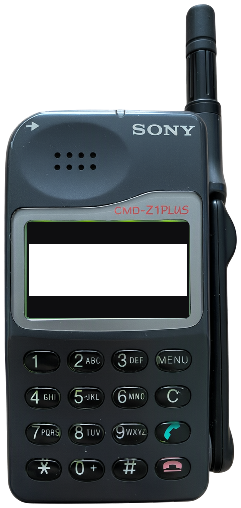
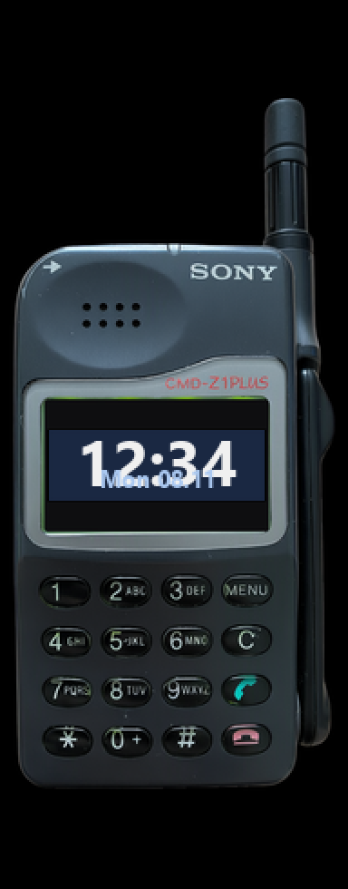

<!-- generated by tools/klapka.py pages: edit phone.json / build.json instead -->

<a href="../../../">KLAPKA</a> · <a href="../../../catalog/years/1997.md">1997</a> · <a href="../">Sony</a> · <a href="../../../catalog/types/flip.md">Flip / clamshell</a>

# Sony CMD-Z1 Plus

  
  &nbsp;&nbsp;
  

| | |
|---|---|
| Year | 1997 |
| Type | flip, shown closed |
| Size | 52.75 × 98.5 mm (closed) |
| Display | 1.53″, 97 × 32 |
| Screen hole in `skin.png` | x 87, y 731, 475 × 157 px |

## Download

Click **Download**; the file saves straight away.

| File | What it is | |
|---|---|---|
| `skin.png` | the phone at 12 px/mm, transparent background, transparent screen | [Download](skin.png?raw=true) |
| `skin-black.png` | the same on a black background, only the screen transparent (for apps that do not accept a transparent background) | [Download](skin-black.png?raw=true) |
| `body.png` | the same without the screen hole | [Download](body.png?raw=true) |
| `mi-band-192x490.png` | ready for a Mi Band 7 / 8 / 9 watch face (192 × 490) | [Download](mi-band-192x490.png?raw=true) |
| `phone.json` | sizes and the screen position, for your own tools | [Download](phone.json?raw=true) |

**Mi Band 7 / 8 / 9:** use `mi-band-192x490.png` as the background and put the clock inside
the screen: x 27, y 237, 119 × 39 px.

## How it was made

Standard v1 ([docs/PIPELINE.md](../../../docs/PIPELINE.md)): measured to scale, re-rendered straight
and clean from a photo, every printed label checked.
Body aspect 0.4666 (spec 0.474), screen at the exact 97:32 aspect.

**Credits:** appearance from a [photo](https://cdn.aukro.cz/images/sk1683039092348/730x548/sony-cmd-z1-plus-funkcni-retro-komplet-159351952.jpeg (photo of the closed phone, via Koks; keystone corrected)); geometry measured on a [photo](https://cdn.aukro.cz/images/sk1683039092348/730x548/sony-cmd-z1-plus-funkcni-retro-komplet-159351952.jpeg); specs: [gsmarena.com](https://m.gsmarena.com/sony_cmd_z1_plus-130.php), [mobile-review.com](https://mobile-review.com/phonemodels/sony/sony-cmd-z1plus.shtml), [mobilecollectors.net](https://mobilecollectors.net/phones/sony-cmd-z1).

Trademarks belong to their owners. KLAPKA is a fan project and is not affiliated with any phone maker.
